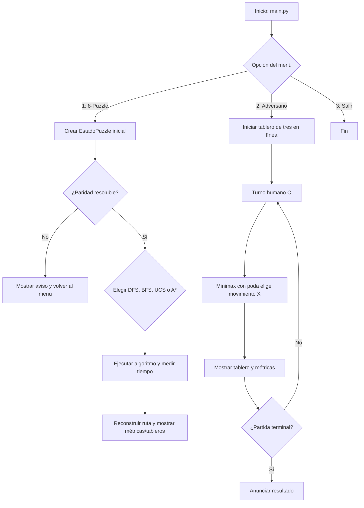
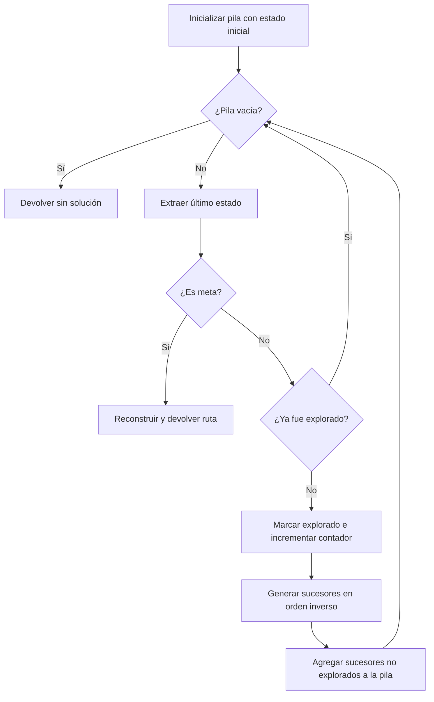
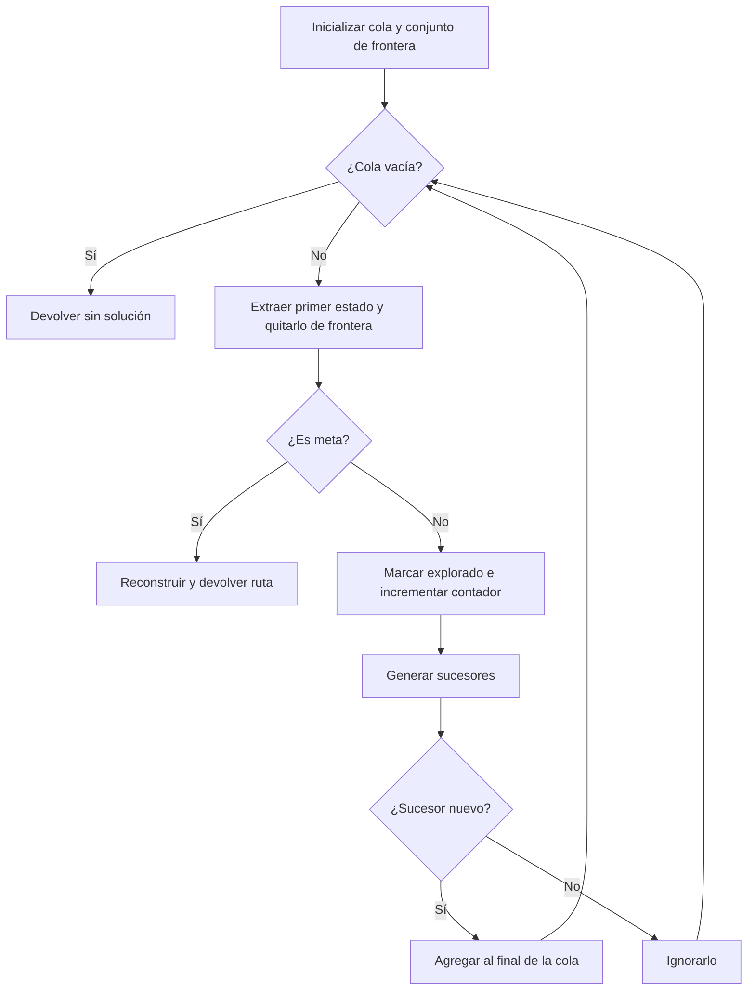
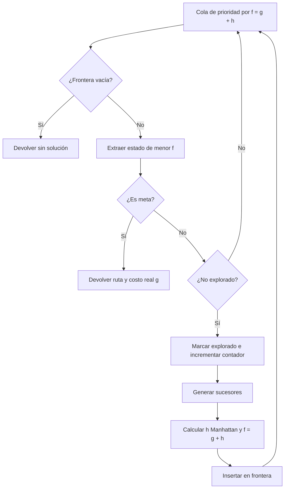
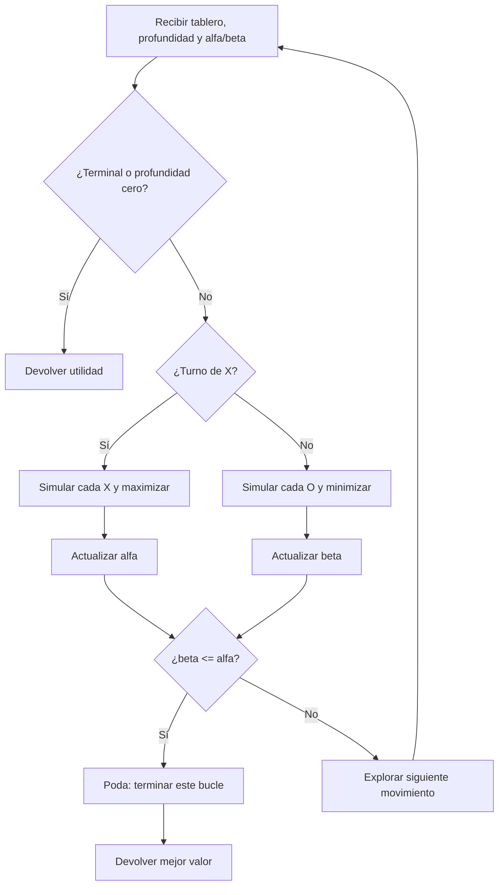

# Proyecto 1: Búsqueda en el 8-Puzzle y juego adversario

## 1. Portada

**Institución:** Universidad del Valle
**Curso:** Inteligencia Artificial  
**Proyecto:** Proyecto 1 - Algoritmos de búsqueda e inteligencia artificial  
**Integrantes:** [Nombres completos]  
**Docente:** [Nombre del docente]  
**Fecha:** 30 de octubre de 2026

> Antes de entregar, reemplace los campos entre corchetes con los datos del
> curso. La versión PDF solicitada puede exportarse a partir de este Markdown;
> la paginación dependerá del formato y del tamaño elegido.

## 2. Introducción

Este proyecto implementa una aplicación de consola para ilustrar dos
problemas clásicos de inteligencia artificial. El primero es el 8-Puzzle, en
el que se ordenan ocho fichas mediante el desplazamiento de un espacio vacío.
El segundo es tres en línea, donde una persona juega contra una máquina que
anticipa las respuestas del oponente.

La motivación es comparar estrategias de búsqueda con distintas formas de
priorizar estados. DFS y BFS no usan información sobre la cercanía a la meta;
UCS usa el costo real acumulado; A* combina ese costo con una estimación
heurística. En el juego adversario, Minimax modela decisiones alternadas y la
poda alfa-beta evita explorar ramas que no pueden cambiar el resultado.

### Objetivos

- Representar el 8-Puzzle como un espacio finito de estados y transiciones.
- Implementar y contrastar DFS, BFS, UCS y A* con un modelo común.
- Aplicar la distancia Manhattan como heurística para A*.
- Implementar Minimax y poda alfa-beta para tomar decisiones en tres en línea.
- Medir nodos, tiempo, longitud/costo de las soluciones y memoria asignada.
- Explicar los resultados, las limitaciones y la manera de ejecutar el programa.

La aplicación tiene un menú principal en [main.py](./main.py), un modelo de
estado en [estado.py](./estado.py), búsquedas no informadas en
[algoritmos_no_informados.py](./algoritmos_no_informados.py), búsquedas
informadas en [algoritmos_informados.py](./algoritmos_informados.py) y el
juego adversario en [minimax.py](./minimax.py).

## 3. Formulación del problema

### 3.1 8-Puzzle como espacio de estados

Un estado es una disposición de las ocho fichas y el espacio vacío en una
cuadrícula de 3 × 3. El espacio de búsqueda es un grafo: cada tablero válido
es un vértice y cada desplazamiento legal del espacio vacío es una arista.
Desde cualquier estado resoluble existen 181 440 configuraciones alcanzables
(la mitad de las 9! permutaciones).

#### a. Representación del estado y estructura de datos

La clase `EstadoPuzzle` guarda:

| Atributo | Propósito |
|---|---|
| `tablero` | Tupla de nueve enteros en orden por filas; `0` representa el espacio vacío. |
| `padre` | Referencia al estado anterior para reconstruir la solución. |
| `accion` | Movimiento del espacio vacío que produjo este estado. |
| `costo_acumulado` | Suma de los costos de las acciones desde el estado inicial. |

La tupla permite usar el tablero como clave en conjuntos de estados
explorados. Los nodos mantienen referencias a sus padres, en vez de copiar la
ruta completa en cada búsqueda. Las transiciones crean un tablero nuevo y no
modifican el tablero del padre.

#### b. Estado inicial, acciones, transición y meta

El estado inicial de la versión revisada del proyecto está definido en
`menu_un_agente()`:

```python
EstadoPuzzle(tablero=(6, 2, 4, 0, 3, 5, 7, 8, 1))
```

Los casos experimentales de la sección 8 usan otras configuraciones
resolubles y se especifican junto a los resultados. El usuario puede cambiar
la tupla en `main.py`. Para un tablero de ancho impar, el número de
inversiones (pares de fichas no vacías fuera de orden) debe ser par para que
la configuración alcance la meta estándar.

Las acciones son `Arriba`, `Abajo`, `Izquierda` y `Derecha`, nombradas según
la dirección en que se mueve el espacio vacío. La ficha que se intercambia
con el espacio vacío se desliza en dirección opuesta. `generar_sucesores()`
calcula la fila y columna del cero, descarta movimientos que saldrían del
tablero e intercambia el cero con la ficha vecina.

La prueba de meta compara el tablero con:

```text
1 | 2 | 3
4 | 5 | 6
7 | 8 | 0
```

#### c. Costos de las acciones

Los costos son intencionalmente distintos:

| Movimiento del espacio vacío | Costo |
|---|---:|
| Arriba | 1 |
| Abajo | 2 |
| Izquierda | 3 |
| Derecha | 4 |

El costo del sucesor es el costo acumulado del padre más el costo de la
acción. BFS y DFS no ordenan sus fronteras por este costo: reportan la
longitud de la ruta. UCS minimiza el costo acumulado. A* usa el costo
acumulado más una heurística.

### 3.2 Modo adversario: tres en línea

El tablero se almacena como una lista de nueve posiciones, inicialmente
vacías. La persona juega con `O` y la IA con `X`. Una acción consiste en
ocupar una casilla libre. Una partida termina cuando un jugador completa una
fila, columna o diagonal, o cuando el tablero queda lleno.

La función de utilidad devuelve `+10` si gana `X`, `-10` si gana `O` y `0`
para empate o estado no terminal alcanzado al límite de profundidad. En
Minimax, la IA maximiza y el oponente minimiza. No se asignan bonificaciones
por ganar antes ni penalizaciones por tardar en perder.

## 4. Arquitectura y diagramas de flujo

### 4.1 Flujo general de la aplicación



### 4.2 DFS (búsqueda en profundidad)



### 4.3 BFS (búsqueda en amplitud)



### 4.4 UCS (costo uniforme)

```mermaid
flowchart TD
    A[Cola de prioridad ordenada por g(n)] --> B{¿Frontera vacía?}
    B -->|Sí| X[Devolver sin solución]
    B -->|No| C[Extraer estado de menor costo acumulado]
    C --> D{¿Es meta?}
    D -->|Sí| Y[Devolver ruta y costo g]
    D -->|No| E{¿No explorado?}
    E -->|No| A
    E -->|Sí| F[Marcar explorado e incrementar contador]
    F --> G[Generar sucesores no explorados]
    G --> H[Insertar con prioridad g del sucesor]
    H --> A
```

### 4.5 A*



### 4.6 Minimax con poda alfa-beta



## 5. Explicación de los algoritmos

Sea `b` el factor de ramificación, `d` la profundidad de la solución, `m` la
profundidad máxima y `C*` el costo de una solución óptima. Las complejidades
indicadas son las cotas clásicas; en la implementación concreta influyen los
estados repetidos, el orden de sucesores y los costos.

### 5.1 DFS

DFS usa una lista como pila LIFO: el último sucesor agregado se procesa
primero. Los sucesores se insertan en orden inverso para que, cuando sea
posible, se explore primero `Arriba`. Al extraer la meta, se reconstruye la
ruta mediante `padre`.

Pseudocódigo:

```text
pila ← [inicio]
explorados ← {}
mientras pila no esté vacía:
    n ← extraer último elemento
    si n es meta: devolver ruta(n)
    si n.tablero no está explorado:
        agregar n.tablero a explorados
        agregar sucesores no explorados a pila
devolver sin solución
```

En un árbol de búsqueda, DFS requiere `O(b^m)` tiempo y típicamente
`O(bm)` memoria. En este proyecto el grafo es finito y `explorados` limita las
expansiones; la pila puede aun contener duplicados y cada estado mantiene su
cadena de padres. DFS es completo en este espacio finito, pero no óptimo: la
primera solución puede ser mucho más larga que la mínima.

### 5.2 BFS

BFS usa `collections.deque` como cola FIFO. `frontera_estados` evita encolar
dos veces una configuración que sigue pendiente y `explorados` registra los
tableros procesados. Al recorrer por niveles, devuelve una ruta con el menor
número de movimientos si cada movimiento cuenta como un paso.

Pseudocódigo:

```text
cola ← [inicio]
frontera ← {inicio.tablero}
explorados ← {}
mientras cola no esté vacía:
    n ← extraer primero
    quitar n.tablero de frontera
    si n es meta: devolver ruta(n)
    agregar n.tablero a explorados
    para s en sucesores(n):
        si s no está en explorados ni en frontera:
            agregar s al final de cola y a frontera
devolver sin solución
```

BFS es completa con factor de ramificación finito y óptima para costos
uniformes por paso. Sus cotas clásicas son `O(b^d)` en tiempo y espacio; en
una implementación de grafo, las estructuras de frontera/explorados pueden
acotarse por el tamaño del grafo alcanzable. Aquí no minimiza los costos
ponderados (1, 2, 3, 4).

### 5.3 UCS

UCS usa `heapq` como cola de prioridad ordenada por `g(n)`, el costo acumulado
real. Un contador secuencial resuelve empates sin comparar objetos
`EstadoPuzzle`. La meta se acepta al extraerla de la frontera. Como los costos
de cada acción son positivos, la primera meta extraída tiene costo mínimo.

Pseudocódigo:

```text
frontera ← cola_prioridad[(0, inicio)]
mientras frontera no esté vacía:
    n ← extraer estado con menor g(n)
    si n es meta: devolver ruta(n), g(n)
    si n no está explorado:
        marcar n explorado
        insertar sucesores con prioridad g(sucesor)
devolver sin solución
```

UCS es completa con costos de paso positivos y es óptima respecto al costo
acumulado. En el análisis clásico, su tiempo y espacio son
`O(b^(1 + floor(C*/ε)))`, donde `ε` es el costo mínimo de una acción. La
frontera puede guardar entradas duplicadas; las entradas repetidas se ignoran
al expandirse si el tablero ya se encuentra en `explorados`.

### 5.4 A*

A* mantiene una cola de prioridad por `f(n) = g(n) + h(n)`. El costo `g` viene
del estado; `h` se calcula con distancia Manhattan. Si extrae la meta,
devuelve el costo real `g`, no `f`.

Pseudocódigo:

```text
frontera ← cola_prioridad[(h(inicio), inicio)]
mientras frontera no esté vacía:
    n ← extraer estado con menor f(n)
    si n es meta: devolver ruta(n), g(n)
    si n no está explorado:
        marcar n explorado
        para s en sucesores(n):
            insertar s con prioridad g(s) + h(s)
devolver sin solución
```

Con una heurística admisible y consistente, y costos positivos, A* es
completo y óptimo. Su peor caso en tiempo y memoria sigue siendo exponencial,
`O(b^d)`, aunque una buena heurística normalmente reduce los estados
explorados. No se implementa una tabla de mejores costos ni reapertura de
estados; la consistencia de Manhattan es importante para justificar que un
estado explorado no necesita reabrirse.

### 5.5 Minimax con poda alfa-beta

Minimax modela un juego de suma cero con decisiones alternadas. `X` elige el
máximo valor y `O` el mínimo. La búsqueda termina ante una victoria, empate o
profundidad cero. La función de utilidad actual es `+10`, `-10` o `0`.

Pseudocódigo:

```text
minimax(n, profundidad, maximizando):
    si n terminal o profundidad = 0: devolver utilidad(n)
    si maximizando:
        valor ← -∞
        para cada movimiento: valor ← max(valor, minimax(hijo))
    si minimizando:
        valor ← +∞
        para cada movimiento: valor ← min(valor, minimax(hijo))
    devolver valor
```

Alfa-beta produce la misma decisión que Minimax, pero conserva límites:
`alfa` es el mejor valor garantizado para el maximizador y `beta` el mejor
para el minimizador. Cuando `beta <= alfa`, las opciones restantes del nodo no
pueden influir en la decisión superior y se podan.

Con profundidad `m` y factor de ramificación `b`, Minimax tiene tiempo
`O(b^m)` y espacio `O(m)` con búsqueda en profundidad. Alfa-beta tiene el
mismo peor caso; con ordenamiento ideal de movimientos puede acercarse a
`O(b^(m/2))`. En este código no hay ordenamiento heurístico de jugadas.
Tres en línea tiene un espacio finito, y la profundidad predeterminada es 9;
desde la respuesta de la IA se alcanza el final de las partidas posibles.
La búsqueda es completa hasta esa profundidad y, al recorrer el árbol completo
de las partidas legales, el movimiento seleccionado es óptimo respecto de la
utilidad definida (`+10`, `-10`, `0`), no respecto de preferencias que la
función no modela, como ganar más rápido.

`mejor_movimiento_ia()` ejecuta ambos algoritmos para cada jugada candidata.
El conteo sin poda sirve para comparación; la jugada se elige con el valor
devuelto por alfa-beta. Las métricas se reinician al comenzar cada decisión.

## 6. Diseño de heurísticas y función de evaluación

### 6.1 Heurística Manhattan de A*

Para cada ficha distinta de cero, Manhattan suma la distancia horizontal y
vertical entre su posición actual y la posición objetivo:

```text
h(n) = Σ (|fila_actual - fila_objetivo|
       + |columna_actual - columna_objetivo|)
```

Ejemplo para el caso P3 de la sección 8:

```text
1 | 2 | 3
0 | 4 | 5
7 | 8 | 6
```

La ficha 4 está a una casilla de su destino, la ficha 5 a una y la ficha 6 a
una; las demás ya están en su posición. Por tanto, `h(inicio) = 1 + 1 + 1 = 3`.
La solución óptima encontrada por UCS y A* mueve el vacío
`Derecha, Derecha, Abajo`; con los costos direccionales, su costo es
`4 + 4 + 2 = 10`.

**Admisibilidad.** Una ficha necesita al menos tantos desplazamientos
individuales como su distancia Manhattan. Cada desplazamiento del puzzle
cuesta como mínimo 1. Por tanto, la suma Manhattan no sobreestima el costo real
que falta.

**Consistencia.** En una transición se mueve una sola ficha una casilla, por
lo que su Manhattan cambia como máximo en 1; las demás distancias no cambian.
Como el costo de esa acción es al menos 1, se cumple
`h(n) <= costo(n,n') + h(n')`.

No se compararon heurísticas alternativas en esta implementación; solo se
utiliza Manhattan. La comparación empírica de la sección 8 es entre algoritmos,
no entre heurísticas.

### 6.2 Utilidad de Minimax y límite de profundidad

El código no evalúa posiciones intermedias ni pondera amenazas: solo asigna
`+10` a una victoria de `X`, `-10` a una de `O` y `0` a empate o corte de
profundidad. Esto es suficiente para tres en línea cuando se alcanza el final
de la partida, pero no distingue una victoria rápida de una tardía ni una
derrota inevitable próxima de una lejana.

El límite de `mejor_movimiento_ia` es 9 por defecto. Después de simular la
jugada candidata `X`, se llama a cada búsqueda con profundidad 8. En un
tablero de tres en línea, esta profundidad permite cubrir las casillas
restantes desde el turno de la IA. La lista de movimientos sigue el orden de
índices, por lo que empates de puntuación conservan la primera casilla
evaluada.

### 6.3 Ejemplo de poda y efecto medido

En una rama minimizadora, si se obtiene `beta = 0` y una continuación de `X`
alcanza `alfa = 10`, entonces `beta <= alfa`; las otras alternativas de esa
rama se pueden ignorar. Este ejemplo ilustra la condición de corte, no una
traza particular de un nodo concreto.

En la medición de la sección 8, después de que la persona juega `O` en el
centro, la IA analizó **55 504** llamadas en la búsqueda sin poda y **6 138**
con alfa-beta. La reducción observada fue de aproximadamente **88,94 %**:

```text
(55 504 - 6 138) / 55 504 × 100 ≈ 88,94 %
```

El resultado es específico de ese tablero, del orden de movimientos y de la
implementación; no es una garantía de reducción para toda posición.

## 7. Evidencias de ejecución

Las pruebas funcionales y métricas reproducibles se resumen aquí. **Las
capturas de pantalla todavía deben insertarse** en los espacios siguientes:
el repositorio no contiene imágenes de las ejecuciones. Para obtenerlas,
ejecute `py main.py` desde la carpeta del proyecto, seleccione las opciones
indicadas y guarde las capturas en una carpeta `evidencias/` junto a este
informe. Para probar los tableros P1–P3, sustituya temporalmente la tupla en
`main.py` por la del caso y vuelva a ejecutar el programa.

| Evidencia | Entrada que se debe seleccionar | Resultado esperado que debe verse |
|---|---|---|
| DFS | Menú `1`, algoritmo `1`, caso P2 | Ruta de 30 movimientos, 30 nodos expandidos. |
| BFS | Menú `1`, algoritmo `2`, caso P3 | `Derecha, Derecha, Abajo`; 18 nodos expandidos. |
| UCS | Menú `1`, algoritmo `3`, caso P3 | Costo mínimo 10; 22 nodos expandidos. |
| A* | Menú `1`, algoritmo `4`, caso P3 | Costo 10; 8 nodos expandidos. |
| Minimax con alfa-beta | Menú `2`; como `O`, jugar en la casilla `4` | IA elige la casilla `0`; conteos 55 504 y 6 138. |

Inserte aquí las capturas antes de exportar el informe:

1. **DFS:** captura de la entrada, la ruta y las métricas.
2. **BFS:** captura del tablero y solución de tres pasos.
3. **UCS:** captura del costo de la solución y nodos.
4. **A\*:** captura del costo de la solución y nodos.
5. **Minimax:** captura de una respuesta de la IA y ambas métricas.

Para DFS en P1 no se recomienda capturar la salida de `main.py`: la ruta
encontrada tiene 106 329 acciones y el menú imprime el tablero por cada paso.
La fila DFS de P2 muestra el comportamiento sin producir una salida de ese
tamaño.

## 8. Análisis comparativo de resultados

### 8.1 Diseño experimental

Se ejecutaron los cuatro algoritmos sobre los mismos tres tableros resolubles:

| Caso | Tablero inicial (filas) | Profundidad mínima BFS |
|---|---|---:|
| P1 | `1 2 3 / 4 5 6 / 7 0 8` | 1 |
| P2 | `1 2 3 / 4 0 6 / 7 5 8` | 2 |
| P3 | `1 2 3 / 0 4 5 / 7 8 6` | 3 |

Se midió con Python 3.11.9 en Windows. El tiempo se tomó con `time.perf_counter`
y el pico de memoria asignada por Python con `tracemalloc`, reiniciado para
cada algoritmo. La instrumentación de memoria añade sobrecarga; los tiempos
no representan exactamente la ejecución normal del menú. El pico de
`tracemalloc` no incluye toda la memoria del intérprete ni debe confundirse
con el RSS total del proceso.

El siguiente fragmento reproduce las mediciones del 8-Puzzle; los tiempos y
la memoria pueden variar entre ejecuciones y equipos:

```python
import time
import tracemalloc

from estado import EstadoPuzzle
from algoritmos_no_informados import ejecutar_dfs, ejecutar_bfs
from algoritmos_informados import ejecutar_ucs, ejecutar_a_star

casos = {
    "P1": (1, 2, 3, 4, 5, 6, 7, 0, 8),
    "P2": (1, 2, 3, 4, 0, 6, 7, 5, 8),
    "P3": (1, 2, 3, 0, 4, 5, 7, 8, 6),
}
algoritmos = [
    ("DFS", ejecutar_dfs),
    ("BFS", ejecutar_bfs),
    ("UCS", ejecutar_ucs),
    ("A*", ejecutar_a_star),
]

for nombre_caso, tablero in casos.items():
    for nombre_algoritmo, ejecutar in algoritmos:
        tracemalloc.start()
        inicio = time.perf_counter()
        camino, nodos, valor_reportado = ejecutar(EstadoPuzzle(tablero))
        segundos = time.perf_counter() - inicio
        _, pico_bytes = tracemalloc.get_traced_memory()
        tracemalloc.stop()

        estado = EstadoPuzzle(tablero)
        costo_ruta = 0
        for accion in camino:
            siguiente = next(
                sucesor for sucesor in estado.generar_sucesores()
                if sucesor.accion == accion
            )
            costo_ruta += siguiente.costo_acumulado - estado.costo_acumulado
            estado = siguiente

        print(
            nombre_caso, nombre_algoritmo, nodos, segundos,
            pico_bytes / 1024, len(camino), valor_reportado, costo_ruta
        )
```

### 8.2 Métricas por algoritmo y caso

| Caso | Algoritmo | Nodos expandidos | Tiempo (s, trazado) | Pico Python (KiB) | Longitud ruta | Costo ponderado de ruta |
|---|---|---:|---:|---:|---:|---:|
| P1 | DFS | 149 859 | 6.363386 | 53 783.4 | 106 329 | 234 948 |
| P1 | BFS | 3 | 0.000894 | 3.0 | 1 | 4 |
| P1 | UCS | 4 | 0.000210 | 2.3 | 1 | 4 |
| P1 | A* | 2 | 0.000204 | 1.6 | 1 | 4 |
| P2 | DFS | 30 | 0.001066 | 9.0 | 30 | 68 |
| P2 | BFS | 8 | 0.000171 | 4.5 | 2 | 6 |
| P2 | UCS | 11 | 0.000206 | 3.5 | 2 | 6 |
| P2 | A* | 4 | 0.000172 | 2.1 | 2 | 6 |
| P3 | DFS | 181 371 | 6.931035 | 58 615.6 | 13 443 | 29 722 |
| P3 | BFS | 18 | 0.000454 | 6.6 | 3 | 10 |
| P3 | UCS | 22 | 0.000476 | 8.3 | 3 | 10 |
| P3 | A* | 8 | 0.000209 | 3.3 | 3 | 10 |

En el código, el tercer valor devuelto por DFS/BFS es la longitud de ruta; el
de UCS/A* es el costo acumulado. La última columna se calculó reproduciendo
cada ruta con los costos de `EstadoPuzzle`, para comparar todas con la misma
medida. Por tanto, el valor “reportado” por BFS/DFS no es el costo ponderado.

### 8.3 Discusión

- **DFS** encuentra una solución en todos los casos, pero no garantiza una
  ruta corta. En P1 el tablero está a un movimiento de la meta y aun así DFS
  devuelve 106 329 movimientos y expande 149 859 nodos. Esto se debe al orden
  de expansión y a que la pila no mantiene un conjunto separado de estados
  pendientes; el ejemplo ilustra por qué una solución encontrada no implica
  optimalidad.
- **BFS** devuelve rutas de longitud mínima en los tres casos. En P1, por
  ejemplo, expande tres nodos antes de extraer la meta. No considera los
  distintos costos de las acciones.
- **UCS** y **A\*** obtienen el mismo costo óptimo en estos casos. UCS expande
  4, 11 y 22 nodos; A* expande 2, 4 y 8, respectivamente. La heurística guía
  A* hacia la meta y reduce expansiones en estos ejemplos pequeños.
- En P2 y P3 las rutas DFS son más largas que las rutas BFS/UCS/A*. Su costo
  ponderado también aumenta (68 frente a 6 en P2; 29 722 frente a 10 en P3).
- Los tiempos medidos son muy pequeños para BFS/UCS/A*, por lo que dependen
  de la máquina y de la instrumentación. No deben interpretarse como una
  clasificación universal de rendimiento.
- La memoria de DFS crece notablemente en P1 y P3. Cada estado conserva una
  cadena de padres y la búsqueda llega a soluciones extremadamente largas.
  Los valores de memoria son picos de asignaciones Python observadas, no
  memoria residente total.

### 8.4 Resultado de Minimax

Para la posición:

```text
  |   |  
---+---+---
  | O |  
---+---+---
  |   |  
```

se obtuvo:

| Métrica | Valor |
|---|---:|
| Jugada seleccionada por la IA | Índice 0 |
| Nodos sin poda | 55 504 |
| Nodos con poda alfa-beta | 6 138 |
| Tiempo con `tracemalloc` activo | 0.991712 s |
| Pico de asignación Python | 1.8 KiB |

La poda reduce el total de llamadas en esta ejecución en aproximadamente
88,94 %. Los nodos corresponden al conjunto de candidatas analizadas por
`mejor_movimiento_ia`; no son solo los nodos de una única jugada ya elegida.

## 9. Conclusiones

El proyecto muestra que la estructura de frontera determina el comportamiento
de una búsqueda. BFS es apropiada cuando se desea minimizar el número de
movimientos; UCS cuando los costos de acción difieren; A* conserva la
optimalidad y aprovecha Manhattan para reducir expansiones. DFS es sencillo y
puede encontrar soluciones, pero el orden de exploración produce rutas muy
malas en algunos tableros.

En tres en línea, Minimax representa las decisiones alternadas, y alfa-beta
reduce trabajo sin cambiar el valor minimax. En la posición medida, la poda
redujo significativamente las llamadas. Los resultados dependen del orden de
movimientos y no implican la misma reducción en todas las partidas.

### Limitaciones y mejoras posibles

- La entrada del 8-Puzzle se cambia editando el código; puede reemplazarse
  por una solicitud validada al usuario.
- DFS puede generar duplicados en la frontera y devolver caminos enormes.
  Mantener un conjunto de estados pendientes evitaría parte de ese trabajo,
  aunque no convertiría DFS en un algoritmo óptimo.
- La búsqueda UCS/A* no implementa actualización de prioridad ni reapertura
  explícita de estados; la corrección de A* depende de la consistencia de la
  heurística usada.
- Manhattan es la única heurística implementada. Se podrían comparar otras
  heurísticas admisibles, registrando nodos, costo y tiempo con una colección
  más amplia de tableros.
- La función de utilidad de Minimax no prefiere victorias rápidas ni demora
  derrotas. Una puntuación con profundidad podría expresar esa preferencia.
- La entrada de tres en línea solo comprueba si la casilla está ocupada; se
  recomienda validar tipo y rango antes de indexar.
- El análisis experimental usa tres tableros muy cercanos a la meta y no
  permite generalizar a instancias difíciles. Conviene agregar tableros de
  mayor profundidad y repetir mediciones.
- Para un análisis más completo de memoria se puede registrar RSS del proceso
  y mantener separadas las cifras de `tracemalloc`.

## 10. Referencias

### Bibliografía

1. Russell, S. J., & Norvig, P. (2021). *Artificial Intelligence: A Modern
   Approach* (4.ª ed.). Pearson.
2. Dijkstra, E. W. (1959). A note on two problems in connexion with graphs.
   *Numerische Mathematik, 1*, 269–271.
   https://doi.org/10.1007/BF01386390
3. Hart, P. E., Nilsson, N. J., & Raphael, B. (1968). A formal basis for the
   heuristic determination of minimum cost paths. *IEEE Transactions on
   Systems Science and Cybernetics, 4*(2), 100–107.
   https://doi.org/10.1109/TSSC.1968.300136
4. Knuth, D. E., & Moore, R. W. (1975). An analysis of alpha-beta pruning.
   *Artificial Intelligence, 6*(4), 293–326.
   https://doi.org/10.1016/0004-3702(75)90019-3
5. Python Software Foundation. (s. f.). *collections — Container datatypes*.
   https://docs.python.org/3/library/collections.html
6. Python Software Foundation. (s. f.). *heapq — Heap queue algorithm*.
   https://docs.python.org/3/library/heapq.html

### Código y herramientas de apoyo

- Código analizado y ejecutado: `main.py`, `estado.py`,
  `algoritmos_no_informados.py`, `algoritmos_informados.py` y `minimax.py`,
  incluidos en este proyecto.
- Python 3.11.9 para las pruebas de ejecución y medición.
- Pylance en Visual Studio Code para validación de sintaxis; mediciones
  experimentales ejecutadas con el intérprete seleccionado del espacio de
  trabajo.
- GitHub Copilot en Visual Studio Code como apoyo para redacción y análisis.
  Las afirmaciones del informe se contrastaron con el código y con las
  ejecuciones resumidas en la sección 8.

## 11. Anexo: manual de ejecución

1. Instale Python 3.
2. Abra una terminal en la carpeta que contiene `main.py`.
3. En Windows ejecute `py main.py` (o `python main.py`). En macOS/Linux,
   ejecute `python3 main.py`.
4. En el menú, seleccione `1` para 8-Puzzle, `2` para tres en línea o `3` para
   salir.
5. Para el 8-Puzzle, elija DFS, BFS, UCS o A*. El tablero inicial se configura
   en `main.py`; debe ser una permutación válida de `0` a `8` y tener paridad
   resoluble.
6. Para tres en línea, juegue como `O` introduciendo el índice `0`–`8` de una
   casilla vacía; la IA juega como `X`.

El proyecto no requiere paquetes externos: usa exclusivamente bibliotecas
incluidas con Python.
